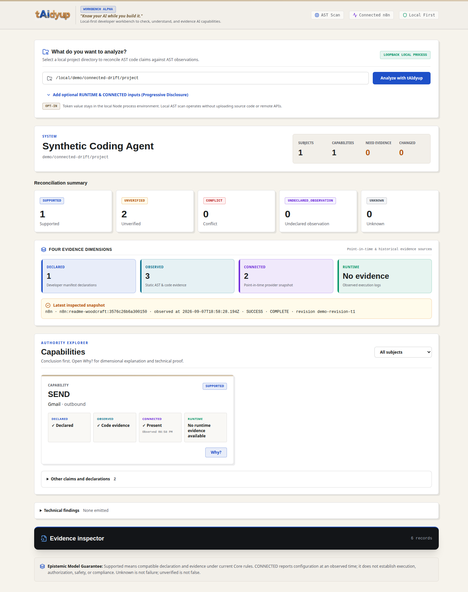
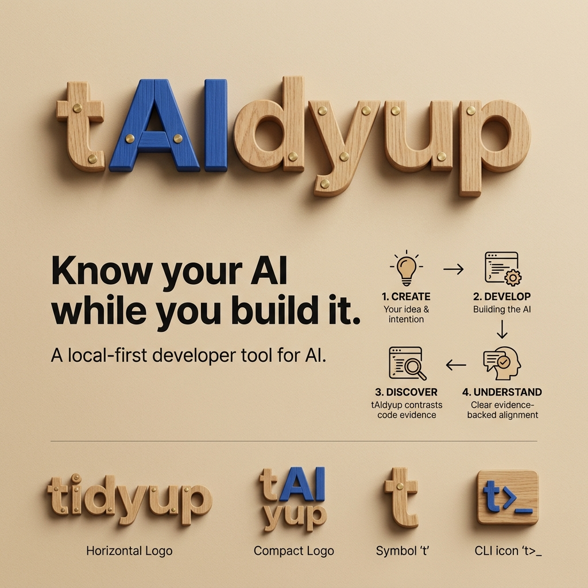

<div align="center">


# tAIdyup

### Know your AI while you build it.

**The local-first, open-source tool for understanding, checking and evidencing what your AI can actually do — from project intent to technical reality.**

[](https://www.npmjs.com/package/taidyup)
[](LICENSE)
[](package.json)

**Align what you declare with what you build.**

</div>

---

## Know your AI from the very beginning

Building an AI system starts before the first line of code. Someone defines its intended purpose, scope, capabilities and boundaries. Developers then turn those intentions into source code, agents, tools, workflows and connections. Later, configurations and observed execution activity may change what the available technical evidence says about the system.

**How do you know whether what you are building still corresponds to what was intended?**

That is the question behind tAIdyup.

tAIdyup examines supported technical signals and, when optional owner-reviewed declarations are supplied, reconciles those signals with declared intent. It makes agreements, contradictions, changes and unanswered questions visible **without promoting technical observations into proof of authorization**.

This is useful to developers who need to understand their systems and potentially to project owners, technical reviewers and AI governance teams who need a traceable technical basis for their own decisions.

The tool does **not** decide whether a project should be approved, whether a capability is organizationally permitted, or whether an AI system complies with regulation. Its current Alpha 3 coverage is deliberately bounded.

## What authority does your AI appear to have — and what evidence supports that?

An AI system can span source code, agents, tools, workflows, models, memory, MCP servers and external configuration. Its apparent authority can change while the project still looks like the same application.

tAIdyup builds an evidence-backed map of what authority your AI **appears** to have. For supported observations and declarations, it helps answer:

- **Who?** Which subject or agent is involved?
- **What?** Which capability is declared or observed?
- **Where?** Which resource is involved?
- **Under what conditions?** Which constraints apply?
- **Why?** What evidence and provenance support the reconciliation result?
- **What changed?** How do saved results or supported connected configurations differ?
- **What remains unknown?** Which conclusions cannot be established?

It preserves the distance between intent, technical evidence, current connected state, observed runtime activity and what remains unknown.

## See your AI, not just another report

Use the **Woodcraft Workbench** graphical interface to explore your AI: move from subjects and capabilities into reconciliation states, evidence, provenance and **Why?**

Use the **CLI and machine-readable outputs** to analyze projects, generate evidence artifacts, compare reports and integrate supported checks into development workflows.

For local analysis, the graphical interface and CLI share the same reconciliation semantics and deterministic **Trust Kernel**. The current repository interface distinguishes DECLARED, OBSERVED, CONNECTED and RUNTIME evidence. It can explicitly inspect one supported n8n CONNECTED source or import a sanitized local RUNTIME artifact.

**Distribution boundary:** the published `taidyup@0.1.0-alpha.3` npm package is **CLI-only**. The Woodcraft Workbench runs from a repository checkout. Report diff, SARIF and the Technical Passport remain CLI-only.



_The current Git-main Woodcraft Workbench analyzing the repository's local synthetic demo fixture. `SUPPORTED` is an evidence-reconciliation state, not a claim of authorization, safety or compliance._

## From development to AI governance

AI governance involves decisions about purpose, responsibility, risk, permitted use and oversight. Those decisions need information about what is being developed and operated. But **declared intent** and **technical evidence** are different things.

tAIdyup helps connect those perspectives:

- **Developers** can inspect supported capabilities, investigate findings and identify changes during implementation.
- **Project owners** can compare owner-reviewed technical declarations with available implementation evidence.
- **Technical reviewers and governance teams** can examine provenance, contradictions and explicit uncertainties as inputs to their own review processes.

For example, an agent may be declared as having read-only access to a resource. During development, a tool appears to enable modification of that resource. **If the relevant subject, action, resource and constraints are sufficiently bound by supported evidence**, tAIdyup can identify a conflict with the declaration.

That result does not establish that the tool was executed, that the modification was unauthorized or that a policy was violated. **It makes a technically supported discrepancy visible for investigation.**

The potential usefulness of this evidence in organizational governance workflows is a hypothesis to validate, not a claim of an implemented governance integration.

## Four perspectives. One reconciliation model.

```text
DECLARED                 optional owner-reviewed intent
    +
OBSERVED                 local source code and supported workflow artifacts
    +
CONNECTED                explicit point-in-time current configuration
    +
RUNTIME                  explicit sanitized local lifecycle evidence
    ↓
Trust Kernel
    ↓
reconciled result + diagnostics + provenance
```

These are **distinct evidence layers**, not mandatory sequential project stages. A project can be inspected without a declaration. A declaration is not automatically inferred from detected code. CONNECTED and RUNTIME require explicit actions and supported inputs.

| Evidence layer | What it can contribute | Important boundary |
| --- | --- | --- |
| **DECLARED** | Owner-reviewed intended capabilities and constraints | Intent is not independently verified or authorized by its presence |
| **OBSERVED** | Supported structural observations from local source and workflow artifacts | Detection is selective; implementation does not prove enablement or execution |
| **CONNECTED** | Explicit point-in-time evidence about one supported current n8n workflow configuration | A snapshot is not monitoring or proof of execution |
| **RUNTIME** | Explicitly imported sanitized local execution lifecycle evidence | Partial observations do not establish a complete history or downstream effects |

### Not everything found is proven

The boundaries matter:

- `DECLARED != VERIFIED`
- `OBSERVED != AUTHORIZED`
- `CONNECTED != AUTHORIZED`
- `IMPLEMENTED != ENABLED`
- `ENABLED != EXECUTED`
- `EXECUTED != AUTHORIZED`
- `AUTHORIZED != COMPLIANT`
- `SAME_WORKFLOW != AGENT_AUTHORITY`
- `STATIC_CONFIGURATION != RUNTIME_RESOURCE`
- `CONNECTED_AT_T != CURRENT_FOREVER`
- `RUNTIME_OBSERVED != UNIVERSALLY_EXECUTED`
- `NO_RUNTIME_EVIDENCE != NOT_EXECUTED`
- `EXECUTION_ATTEMPTED != EXECUTION_SUCCEEDED`
- `TOOL_SUCCEEDED != RESULT_CORRECT`

tAIdyup requires evidence for subject, capability and resource relationships. Similar names or coexistence in a repository or workflow are not treated as identity or authority bindings.

For a technical reviewer, preserving these distinctions is part of the value: the evidence should never imply a stronger conclusion than it supports.

## Try it

Requires **Node.js 18+**.

### Published npm Alpha 3 — CLI only

The published `taidyup@0.1.0-alpha.3` npm artifact includes `init`, `scan`, `validate`, `report`, `diff`, explicit `connected-n8n` and explicit `runtime-import`. It does **not** contain or launch the Woodcraft Workbench.

```bash
npm install -g taidyup@alpha
taidyup --help
```

### Repository/local development UI — Woodcraft Workbench

The Woodcraft Workbench, native folder-picker bridge, bundled onboarding demo, guided tour and local UI are repository capabilities:

```bash
git clone https://github.com/AnarQorp/taidyup.git
cd taidyup
npm install
npm run build
npm run ui
```

Open `http://127.0.0.1:3001`, choose a folder or enter an absolute local path, then analyze. The bundled demo uses versioned synthetic local evidence; it does not connect to a provider or execute a workflow.

### CLI quick start — inspect first, declare later

```bash
taidyup scan ./your-ai-project
taidyup validate ./your-ai-project
taidyup report ./your-ai-project
taidyup diff previous-report.json current-report.json
```

No `taidyup.json` is required for these inspections. Without a declaration source, `declarationContext` is `ABSENT`: tAIdyup can report supported technical observations but cannot infer intended authority.

Declarations provide **optional additional reconciliation context**. To adopt one, run `taidyup init ./your-ai-project`, review and explicitly complete the generated non-declarative `taidyup.json.draft`, then run `taidyup init ./your-ai-project --accept`.

Scanner suggestions are **never** promoted into owner declarations automatically. Alpha 3 supports JSON declarations in `taidyup.json`; real YAML parsing is not supported. An organizational questionnaire or AI register is not automatically imported.

## Check apparent authority dimension by dimension

A declaration is more than an action name. tAIdyup assesses **subject, predicate, action, resource and declared constraints** against relevant evidence.

Conceptual example:

| Claim or observation | Result | Why |
| --- | --- | --- |
| Declared `READ` repository | `SUPPORTED` | Every mandatory dimension has sufficient compatible evidence. |
| Declared `WRITE` files | `UNVERIFIED` | Available evidence does not establish every required binding, resource or constraint dimension. |
| Declared `CANNOT EXECUTE` shell | `CONFLICT` | Bound evidence explicitly contradicts the prohibition. |
| Observed agent-bound `EXECUTE` shell | `UNDECLARED_OBSERVATION` | Sufficiently bound evidence supports the capability, but no compatible declaration covers it. |

This illustrates the model, not the result of analyzing a particular project.

A `CONFLICT` identifies an evidence-backed contradiction worth investigating. `UNVERIFIED` identifies insufficient evidence, not a false declaration. `SUPPORTED` means mandatory claim dimensions are supported by compatible evidence; it does **not** mean verified identity, execution, authorization, safety or compliance.

## The five reconciliation states

| State | Meaning |
| --- | --- |
| **`SUPPORTED`** | Every mandatory claim dimension has sufficient compatible evidence. Review provenance; this is not authorization or certification. |
| **`UNVERIFIED`** | One or more mandatory dimensions lack sufficient evidence. The declaration is not thereby false. |
| **`CONFLICT`** | Relevant bound evidence explicitly contradicts a declared dimension or prohibition. |
| **`UNDECLARED_OBSERVATION`** | A sufficiently bound observed capability is not covered by a declaration. |
| **`UNKNOWN`** | Evidence is ambiguous, unsupported, incomplete or outside current coverage. Uncertainty is preserved rather than guessed away. |

These are **technical reconciliation states**, not governance approval statuses.

## See configured-authority drift

AI systems keep changing after an initial technical review. The current CONNECTED V0 was validated against a **disposable n8n 2.37.10 instance** and a synthetic workflow:

```text
T1
Declared SEND    ✓
Observed SEND    ✓
Connected SEND   ✓
→ SUPPORTED

        n8n configuration changes

T2
Declared SEND    ✓
Observed SEND    ✓
Connected SEND   absent
→ UNVERIFIED
→ CURRENT_STATE_DRIFT
```

At T1, the workflow revision reported an explicit AI Agent → Gmail tool relationship that mapped to configured `SEND`. After the Gmail tool was removed outside the collector, T2 also emitted `CONNECTED_ABSENCE_OBSERVED`; earlier evidence remained in provenance.

tAIdyup established that the **supported current configuration changed**. It did **not** establish email execution, credential validity, authorization or compliance. The difference may prompt a developer or reviewer to revisit an earlier technical conclusion, but does not itself determine whether a governance policy was breached.

This is an explicit point-in-time comparison, **not continuous monitoring**. Report diff is separate: `taidyup diff` compares two saved results. Neither failed nor partial CONNECTED retrieval is treated as evidence of absence.

## Evidence sources currently supported

### Source code

Selective static detection and structural binding for supported patterns in **LangChain/LangGraph** (Python and TypeScript), **CrewAI** (Python), **AutoGen** (Python), **LlamaIndex** (Python and TypeScript), **Semantic Kernel** (Python and C#), and **MCP** configuration/tool schemas.

Coverage is pattern-based and incomplete. A target not analyzed or recognized is **not** evidence that it is non-AI or lacks authority.

### Local workflow artifacts

A conservative, version-aware subset of local **n8n workflow JSON**. Selected agent, tool, model, memory and consequential-operation semantics are mapped only when supported graph relationships justify them. Expressions are not evaluated; unsupported nodes or versions remain `UNMAPPED`.

### CONNECTED n8n current configuration

An explicit point-in-time retrieval for one selected workflow, retaining current configuration, identity/revision context, completeness and sanitized provenance.

It does not turn `active` into executed, equate draft with published state, or treat a credential reference as credential validity or authorization.

### RUNTIME

RUNTIME V0 explicitly imports a strict, sanitized local **JSONL** artifact produced by the deterministic local tool wrapper. It distinguishes attempted, started and completed execution lifecycle events, source-reported success/failure, evidence-backed dimensional binding, partial observation and unbound observations.

It does **not** monitor providers, retain tool payloads, prove authorization, verify downstream effects, establish result correctness or claim a complete execution history.

```bash
taidyup runtime-import ./runtime.jsonl ./project
taidyup validate ./project --runtime-artifact ./runtime.jsonl
taidyup report ./project --runtime-artifact ./runtime.jsonl
```

The repository also contains an **OpenTelemetry composition lab** used only by tests to validate mapping into the RUNTIME V0 contract. It is **DEV VALIDATION ONLY**, not supported telemetry ingestion, monitoring, instrumentation or a runtime collector.

## Explicit CONNECTED n8n inspection

The current repository provides an opt-in `connected-n8n` command for **one explicitly selected workflow**:

```bash
export N8N_API_KEY='your-api-key'

node bin/taidyup.js connected-n8n \
  --base-url https://your-n8n.example \
  --workflow WORKFLOW_ID \
  --connection-id my-n8n \
  --token-env N8N_API_KEY \
  --authority-mode UNKNOWN \
  --observed-artifact ./workflow.json \
  --manifest ./taidyup.json
```

Before retrieval, the CLI discloses the provider, target origin, GET endpoint classes, reported authority mode and `execution=false`.

CONNECTED V0:

- is disabled unless this explicit command is used;
- connects directly from the developer's machine—there is no tAIdyup cloud proxy;
- uses bounded workflow-list and exact-workflow `GET` requests;
- rejects redirects and mutating HTTP methods;
- reads the token only from the named environment variable;
- sanitizes current configuration and reconciles it locally;
- does not call credential or execution endpoints;
- does not validate credentials, infer authorization, execute workflows, poll or monitor.

A client that only sends `GET` is **not necessarily using a technically read-only credential**. tAIdyup reports `TECHNICALLY_READ_ONLY` only when provider evidence establishes that property; otherwise the effective mode remains client-enforced or unknown.

## Outputs and automation

```bash
taidyup report .
```

generates:

- `taidyup-report.json` — machine-readable `ReconciledTrustState`;
- `TECHNICAL_PASSPORT.md` — human-readable technical evidence summary;
- `taidyup.sarif` — SARIF 2.1.0 findings for compatible tooling such as GitHub Code Scanning.

```bash
taidyup diff base-report.json target-report.json
```

compares two saved reconciliation reports and summarizes structural capability-evidence changes. It does not establish an authorization change; it is an explicit comparison, not monitoring or history storage.

These outputs support different conversations. Developers can investigate technical findings and automate checks; project owners and reviewers can examine the same evidence, provenance and uncertainty. **They are inputs to review, not compliance reports or certificates.**

These outputs are available through the CLI. They are not currently views inside the graphical interface.

## How the Trust Kernel works

The deterministic **Trust Kernel** is the technical core of tAIdyup. It prevents evidence from becoming a stronger claim than it can support. It reconciles owner-reviewed declarations without guessing intent or treating a detector hit as universal truth.

```text
Evidence relevant to a claim
    ↓
subject · predicate · action · resource · constraints
    ↓
dimensional reconciliation
    ↓
ReconciledTrustState + diagnostics + provenance
```

Reconciliation considers identity, scope, dimensions, provenance and time. Partial or failed CONNECTED retrievals cannot establish absence, and newer evidence is not automatically stronger in every dimension.

A technical observation must not silently become a declaration. A configured capability must not become proof of execution. Observed execution must not become proof of authorization. Supported declarations must not become claims of compliance.

The detailed semantic contract lives in [the epistemic model](docs/EPISTEMIC_MODEL.md).

## Local-first, with an explicit network boundary

Default local analysis:

- makes no network requests;
- uploads no source code;
- emits no telemetry;
- analyzes, reconciles and stores outputs locally;
- does not require a mandatory external language model or token for the default local analysis.

CONNECTED n8n inspection:

- requires explicit user opt-in and a configured target;
- connects directly to that target using bounded `GET` requests;
- keeps analysis and reconciliation local;
- uses no tAIdyup cloud control plane or telemetry.

Local-first does **not** mean that an explicitly requested CONNECTED inspection is offline. The CLI makes the network boundary visible before retrieval.

This approach may be useful where teams want greater control over technical evidence and code handling. Local-first alone does not guarantee confidentiality, security or regulatory compliance.

## Current limits

tAIdyup is an **Early Alpha**. Its useful limits include:

- source scanner coverage is selective and can miss capabilities or produce false positives;
- JSON is the supported declaration format; real YAML parsing is not supported, and an existing uninterpretable `taidyup.yaml` is an invalid declaration source rather than an absent one;
- the npm Alpha 3 artifact is CLI-only; the Woodcraft Workbench is run from a repository checkout;
- workflow mappings use a deliberately small allowlist rather than universal n8n understanding;
- n8n is the first and only implemented workflow and CONNECTED provider;
- unknown/community nodes and unsupported versions remain `UNMAPPED`;
- dynamic expressions and runtime-selected resources remain unresolved;
- credential validity and scopes are not checked;
- CONNECTED snapshots are point-in-time, not continuous monitoring;
- RUNTIME V0 is explicit, local, partial and limited to its strict provider-neutral lifecycle schema;
- subworkflow authority is not automatically flattened;
- the graphical interface supports explicit n8n CONNECTED inspection and explicit sanitized RUNTIME artifact import, but not diff, Passport, SARIF or monitoring;
- tAIdyup does not establish authorization, safety, security or compliance.

**Governance-specific boundaries:**

- tAIdyup does not maintain an organizational AI inventory or governance register;
- it does not automatically import governance questionnaires, REGSIA declarations or equivalent forms;
- it does not classify AI systems under the EU AI Act or perform legal conformity assessments;
- it does not implement organizational approval workflows, assign governance responsibilities or replace risk management;
- technical evidence may support such activities, but integration into them is **not** an implemented Alpha 3 capability.

`UNKNOWN`, `UNVERIFIED` and `UNMAPPED` are legitimate results. They identify the edge of current evidence instead of hiding it.

## Verification

The repository includes adversarial and integration tests for Trust Kernel reconciliation, dimensional claim matching, CONNECTED evidence selection and absence, guarded n8n transport, workflow graph binding, scanner provenance, CLI opt-in, the local UI bridge and the default no-network boundary.

The CONNECTED V0 proof used a disposable n8n 2.37.10 instance with synthetic workflows and **no workflow execution**. Tested behavior is evidence about these implemented contracts; it is not proof of universal correctness across every AI system or n8n version.

For reviewers, distinguish **implemented capability**, **validated behavior**, **known limitation** and **potential use case**. Governance usefulness is a potential application to validate, not an implemented regulatory workflow.

## Built for developers. Useful beyond development.

tAIdyup was created to help people understand what their AI systems can actually do while building them. That purpose has not changed.

Developers need to understand capabilities, bindings, configurations and execution evidence. Project owners may need to compare intended behavior with technical reality. Reviewers may need to distinguish supported findings from assumptions. Governance teams may need evidence to inform decisions for which they remain responsible.

tAIdyup does not replace any of those roles. It offers a **common, bounded technical evidence foundation** that may help them understand the same system from different perspectives.

**Know your AI while you build it.**

Because understanding what you are building is part of being responsible for what it becomes.

## Early Alpha — help us test it

Try tAIdyup on a supported AI project, or review its evidence model and technical limits. Tell us:

- Did it show you something useful or surprising?
- Did it misunderstand a capability or relationship?
- Was something `UNKNOWN` that you expected it to understand?
- Can you trace a finding to its supporting evidence?
- Are declared, observed, connected and runtime perspectives clearly distinguishable?
- Would a conflict, unknown or report diff help an existing technical or governance review?
- What information would still be missing before relying on the result?
- Would you run it again after changing your AI system?

- [Report a CLI bug](https://github.com/AnarQorp/taidyup/issues/new?template=bug_report.md)
- [Report detection feedback or a false positive](https://github.com/AnarQorp/taidyup/issues/new?template=detection_feedback.md)
- [Request framework or detector support](https://github.com/AnarQorp/taidyup/issues/new?template=framework_request.md)
- [Suggest a feature](https://github.com/AnarQorp/taidyup/issues/new?template=feature_request.md)
- [Share your Early Alpha experience](https://github.com/AnarQorp/taidyup/issues/new?template=alpha_feedback.md)

## Brand

tAIdyup's visual identity is inspired by Pinocchio and handcrafted wooden block mechanics: creation, development, discovery and evidence-backed understanding. See [Brand Identity](docs/BRAND_IDENTITY.md).

---

<div align="center">



### What authority did your AI gain while you were building it?

**tAIdyup** — Open source · Local-first · Alpha

</div>
